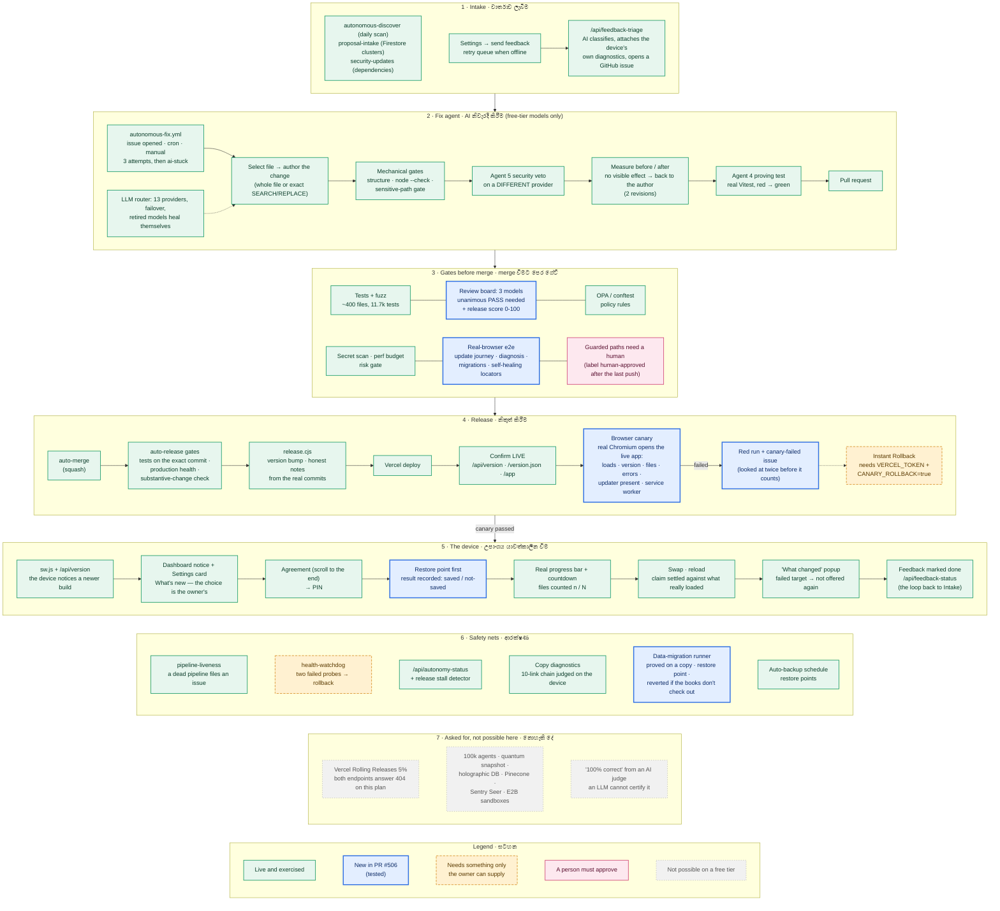
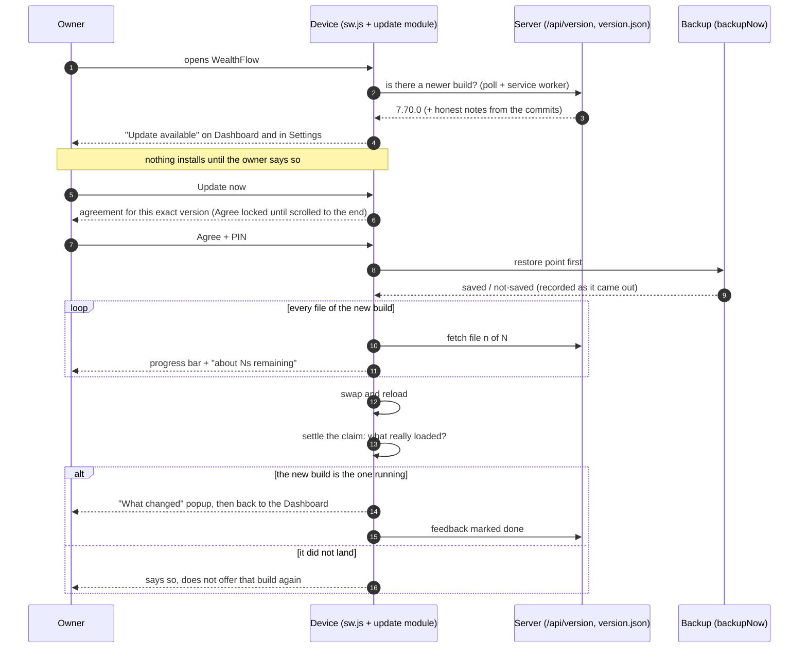

# WealthFlow update system on one page

This is the whole path from "the owner types a report" to "the owner's phone runs the fix", and the safety nets around it.
Every box is something that exists in this repository today. Colour says how far to trust it:

* **green** is live and was exercised by a test or a run;
* **blue** is new in PR #506 (this work): tested, and live after that PR is released;
* **amber** is built but needs something only the owner can supply (a token or a repository variable), so it is **not** claimed as running;
* **grey, dashed** is something the research report asked for that is not possible on a free tier, with the reason.

The same picture, rendered, is `update-system-diagram.svg` / `.png` in the project files.

## 1. The whole system

## 2. One update on the owner's phone (the iOS / Android path)

## 3. What each Omni-Matrix idea became

| Idea in the research report | In this repository | Status |
|---|---|---|
| Agentic self-repair from feedback | issue → 5-role swarm → proving test → PR (`autonomous-fix.yml`) | live; it opened no PR on its own yet, see the report |
| LLM-as-a-Judge in CI/CD | 3-model review board, unanimous stated PASS, now with a 0-100 release score and a refusal of a PASS under 60 | live after #506; the **score is not the gate**, the unanimous PASS and the deterministic checks are |
| "Only 100% correct and safe is approved" | cannot be certified by an LLM; the gates are tests, fuzz, policy rules, secret scan, budgets, a real browser | stated honestly |
| Self-healing DOM, agentic QA | `test/e2e/heal.mjs`: ordered locators, ambiguity refused, every heal logged with the selector to use, a missing control still fails | live after #506 |
| Autonomous schema migrations with rollback | `wealthflow-migrations.js`: proved on a copy, restore point first, reverted on any failure, registry empty today | live after #506 |
| Canary / Rolling Releases, 5% first | Rolling Releases unavailable (404); a real-browser canary opens the live release, optional Instant Rollback | canary live after #506; rollback needs `VERCEL_TOKEN` and `CANARY_ROLLBACK=true` |
| Instant Rollback | `health-watchdog.yml` (two failed probes) and the canary | needs `VERCEL_TOKEN` and `HEALTH_URL` from the owner |
| 100,000 agents, quantum snapshot, holographic DB, Pinecone, Sentry Seer, E2B | none of these is possible on a free tier | not built, said plainly |
